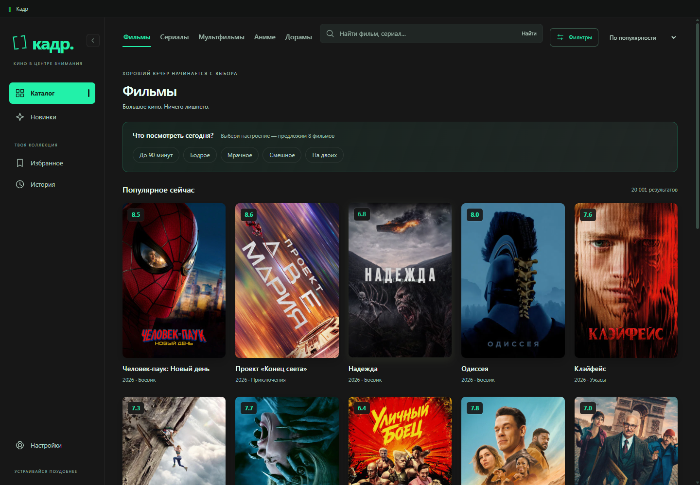

# Кадр

**Кино в центре внимания.** Приложение для Windows, в котором удобно выбирать фильмы и сериалы, хранить свою коллекцию и смотреть видео.

Первая версия — **1.0.0**.

Разработано с помощью **OpenAI Codex**.

## Возможности

- Отдельные разделы: фильмы, сериалы, мультфильмы, аниме и дорамы.
- Поиск, фильтры и подборки мультфильмов по студиям.
- Избранное и история просмотров.
- Семь цветовых тем: Стандартная, Тёмная, Светлая, Лемон, Тиффани, Матча и Аква.
- Встроенный видеоплеер и выбор установленного внешнего приложения.
- Настройки подключения и проверка доступности каталога.

## Скачать и запустить

[**Скачать для Windows x64**](https://github.com/xxcakesxx6-wq/Kadr/releases)

В разделе Releases выбери `Kadr-1.0.0-windows-x64.zip`.
Распакуй архив целиком в отдельную папку и запусти **Kadr.exe**. Установка не требуется.

Поддерживается Windows 10/11 x64. Для каталога, постеров и онлайн-источников нужен интернет. Доступность источников зависит от сторонних сервисов.

## Лицензия и компоненты

Код проекта распространяется под **GPL-2.0**; см. [LICENSE](LICENSE). Сведения об исходных авторах, встроенном движке и библиотеках собраны в [THIRD_PARTY_NOTICES.md](THIRD_PARTY_NOTICES.md).

This product uses the TMDB API but is not endorsed or certified by TMDB.

Для разработчиков: [запуск и сборка из исходников](docs/DEVELOPMENT.md).
